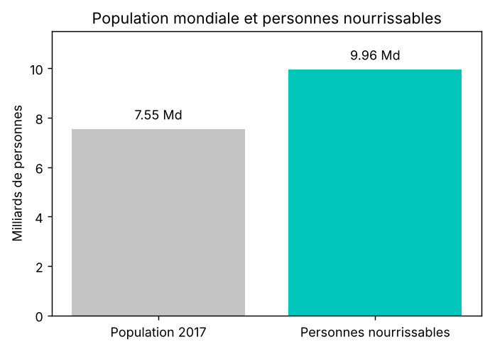
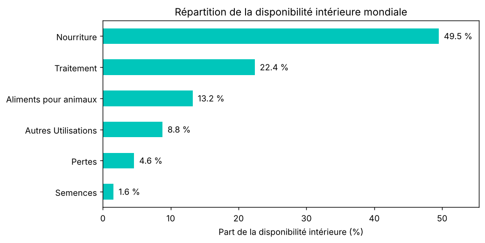
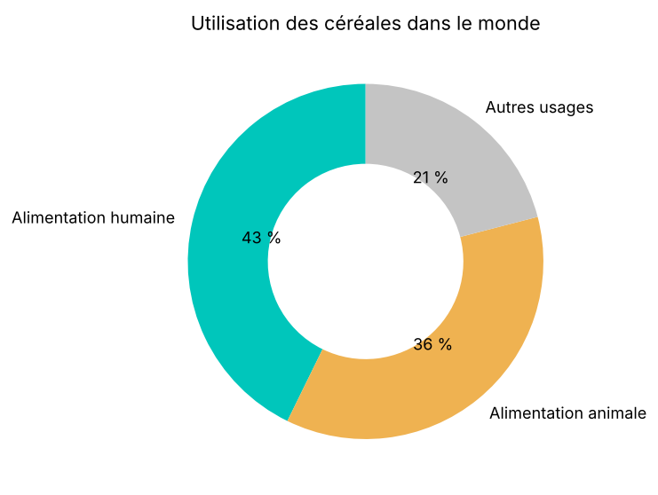
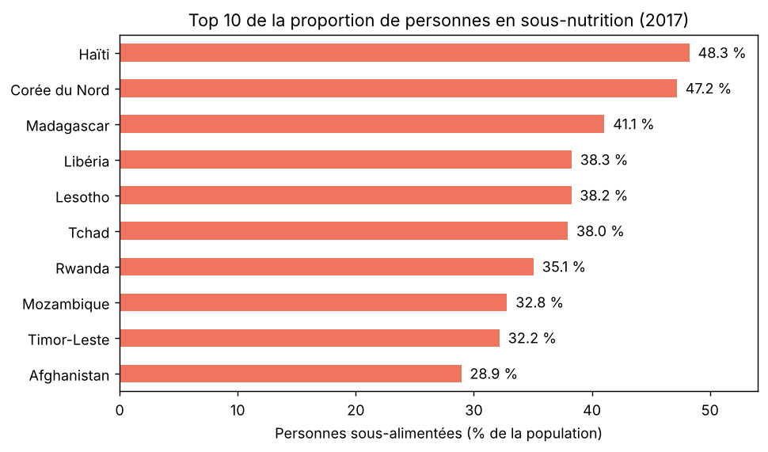
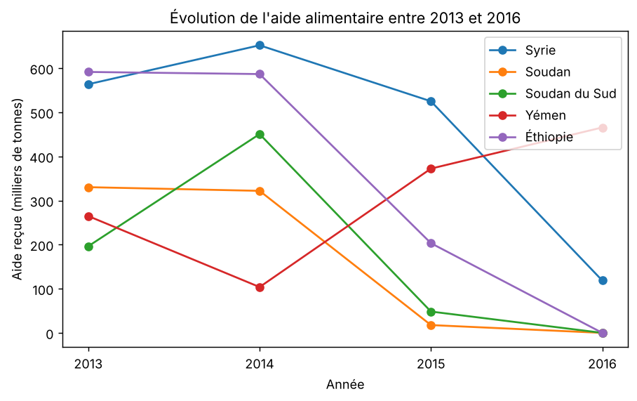
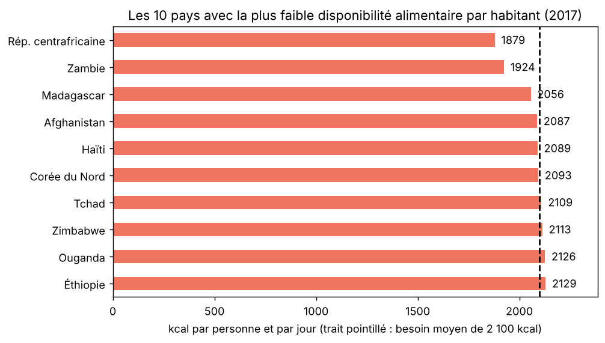

# Étude de santé publique : l'alimentation dans le monde (FAO)

Analyse de données réalisée avec **Python et pandas** pour répondre à une question de la FAO : *y a-t-il assez à manger pour tous, et où se situe le problème ?*

Projet réalisé dans le cadre de la formation **Data Analyst** (OpenClassrooms, projet 4), à partir de données FAOSTAT sur la période 2013-2017.

## Résultat en bref

| Question | Résultat |
|---|---|
| Personnes en sous-nutrition en 2017 | **535,7 millions**, soit **7,1 %** de la population mondiale (minimum) |
| Personnes que la nourriture disponible permettrait de nourrir | **9,96 milliards**, pour 7,55 milliards d'habitants |
| Avec les seuls produits végétaux | **8,22 milliards** (≈ 83 % du total) |
| Part de la disponibilité intérieure qui va à l'alimentation humaine | **49,5 %** |
| Céréales : alimentation humaine / animale | **43 %** / **36 %** |
| Pays les plus touchés (proportion de sous-alimentés) | Haïti (48 %), Corée du Nord (47 %), Madagascar (41 %) |

**Conclusion :** il y a assez de nourriture au total, mais elle est mal répartie et une partie n'est pas destinée à l'alimentation humaine.





## Contexte et objectifs

La FAO souhaite comprendre la sous-nutrition dans le monde. L'analyse porte sur la partie « historique » (2013 à 2017) et répond à six questions :

1. Quelle proportion de la population mondiale est en état de sous-nutrition en 2017 ?
2. Combien de personnes la nourriture disponible permettrait-elle de nourrir, avec tous les produits, puis avec les seuls végétaux ?
3. Comment se répartit la disponibilité intérieure (alimentation humaine, animale, pertes, semences, etc.) ?
4. Quelle part des céréales sert à l'alimentation humaine et animale ?
5. Quels pays sont les plus touchés, et lesquels ont reçu le plus d'aide alimentaire ?
6. Un exemple concret : la Thaïlande et le manioc.

## Données

Quatre fichiers CSV issus de la base **FAOSTAT**, fournis dans le cadre du projet. Ils ne sont **pas inclus** dans ce dépôt (voir [`data/README.md`](data/README.md)).

| Fichier | Contenu | Lignes |
|---|---|---|
| `population.csv` | Population par pays, 2013 à 2018 | 1 416 |
| `dispo_alimentaire.csv` | Disponibilité alimentaire par pays et par produit, 2017 | 15 605 |
| `aide_alimentaire.csv` | Aide alimentaire par pays, année et produit, 2013 à 2016 | 1 475 |
| `sous_nutrition.csv` | Personnes sous-alimentées par pays, moyennes sur 3 ans | 1 218 |

## Méthodologie

1. **Nettoyer** : mise des fichiers dans la même unité (habitants, kg), conversion des valeurs de sous-nutrition en nombres (`errors='coerce'`), valeurs manquantes remplacées par 0.
2. **Relier** : jointures sur le nom du pays (`pd.merge`) entre la population, la disponibilité alimentaire et la sous-nutrition.
3. **Calculer** : nouvelles colonnes (kcal disponibles par jour pour tout un pays, proportion de sous-nutrition), regroupements par pays et par année (`groupby`), filtres (`.loc`, `.isin()`).
4. **Contrôler** : équation du bilan alimentaire vérifiée sur des exemples, totaux recoupés, ordres de grandeur, vérification des dimensions (`.shape`) après chaque jointure.
5. **Visualiser** : graphiques `matplotlib` dans le notebook.

Hypothèse centrale : un adulte a besoin en moyenne de **2 100 kcal par jour** (valeur de planification du PAM et du HCR), ce qui permet de convertir les calories disponibles en nombre de personnes nourrissables.

## Autres résultats









**Exemple de la Thaïlande :** 9 % de la population est sous-alimentée, alors que 83,4 % du manioc produit est exporté. Le manioc ne fournit que 40 kcal par personne et par jour (contre 1 139 pour le riz) : son export n'explique donc pas la sous-nutrition.

## Limites

- **Valeurs vides comptées à 0** : en 2016-2018, 99 pays n'ont aucune valeur de sous-nutrition et 20 ont la valeur « <0.1 ». Le total et le classement sont donc des **minimums**, et certains pays très touchés (par exemple la République centrafricaine et le Zimbabwe) sont absents du top 10.
- **Besoin moyen unique de 2 100 kcal** : il ne tient compte ni de l'âge, ni de l'activité, ni du pays.
- **Disponibilité n'est pas consommation** : c'est une moyenne nationale, pas ce que chaque habitant mange.
- **Aide alimentaire** : les lignes « Céréales » et « Non-céréales » semblent être des sous-totaux, donc les valeurs en kg sont peut-être doublées (le classement ne change pas). Cette hypothèse reste à confirmer.
- L'étude porte sur une seule année pour la disponibilité (2017).

## Structure du dépôt

```
.
├── README.md
├── requirements.txt
├── notebook/
│   └── etude_sante_publique_faim_monde.ipynb   # analyse complète, avec les sorties
├── docs/
│   └── presentation.pdf                        # support de présentation
├── images/                                     # graphiques utilisés dans ce README
└── data/
    └── README.md                               # où trouver les fichiers CSV
```

## Reproduire l'analyse

1. Cloner le dépôt et créer un environnement virtuel :

   ```bash
   git clone https://github.com/[votre-compte]/faim-monde-etude-sante-publique.git
   cd faim-monde-etude-sante-publique
   python -m venv .venv
   .venv\Scripts\activate        # Windows (Linux et macOS : source .venv/bin/activate)
   pip install -r requirements.txt
   ```

2. Placer les 4 fichiers CSV dans le dossier `data/` (voir `data/README.md`).
3. Ouvrir `notebook/etude_sante_publique_faim_monde.ipynb` (VS Code ou Jupyter) et exécuter **Restart + Run All**.

## Compétences mobilisées

- Python : `pandas` (jointures, filtres, regroupements, nouvelles colonnes), `matplotlib`
- Nettoyage de données, gestion des unités et des valeurs manquantes
- Contrôle qualité et documentation des hypothèses et des limites
- Communication des résultats (notebook commenté et présentation)

## Auteur

Ahmed Moundji ZID · 

Données : FAO (FAOSTAT). Projet pédagogique réalisé dans le cadre de la formation Data Analyst d'OpenClassrooms.
